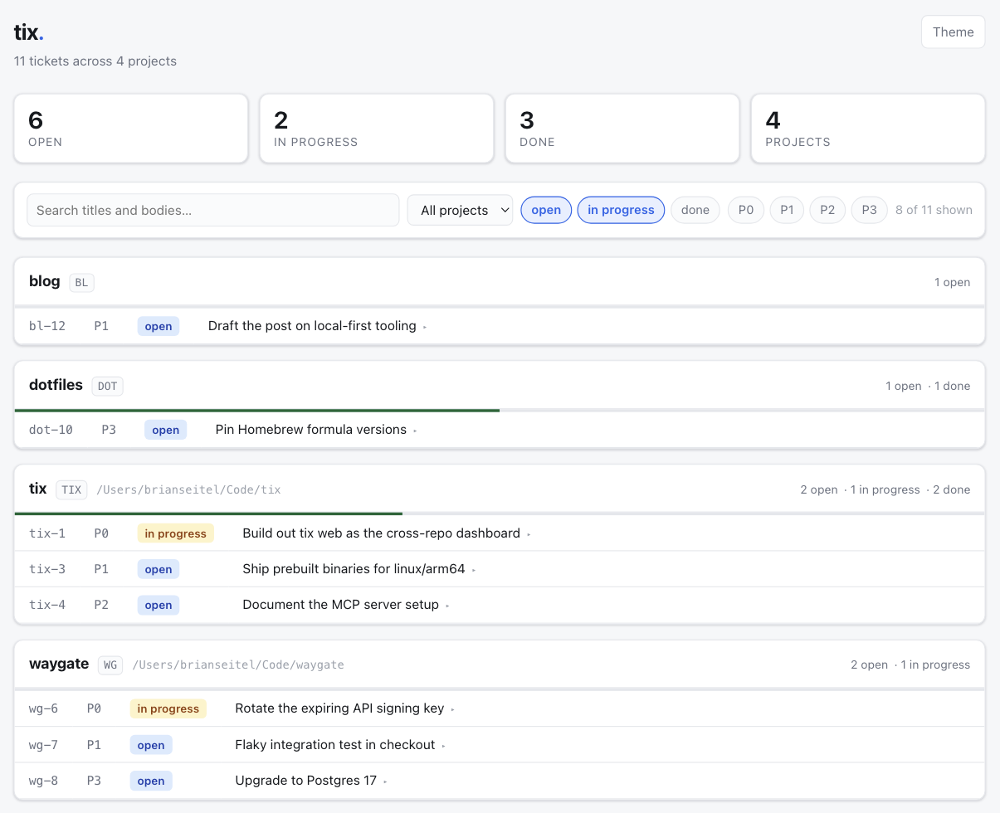

# tix

[](https://github.com/waygatetech/tix/actions/workflows/test.yml)
[](https://github.com/waygatetech/tix/releases/latest)
[](go.mod)
[](LICENSE)

`tix` is a lightweight command-line ticket tracker for solo devs and small teams. It stores tickets in a local SQLite database (`~/.tix/tix.db` by default) and scopes work by project, so one database can track tickets for every project you touch.

No server, no account, no config file — just a single binary and a SQLite file.

Because every project lives in one database, `tix web` can show all of them at once — the view a tracker that lives inside a single repository cannot give you:



## Install

### Prebuilt binary (no Go required)

Download the archive for your platform from the [latest release](https://github.com/waygatetech/tix/releases/latest), extract it, and put the `tix` binary on your `PATH`, e.g.:

```sh
# macOS (Apple Silicon) example — swap in the archive for your OS/arch
curl -sL https://github.com/waygatetech/tix/releases/latest/download/tix_darwin_arm64.tar.gz | tar xz
sudo mv tix /usr/local/bin/
```

Binaries are published for macOS, Linux, and Windows (amd64 and arm64).

### With Go

Requires [Go](https://go.dev/dl/) 1.25+.

```sh
go install github.com/waygatetech/tix@latest
```

Make sure `$(go env GOPATH)/bin` is on your `PATH` so the `tix` binary is available in your shell.

To build from source instead:

```sh
git clone https://github.com/waygatetech/tix.git
cd tix
go build .
```

## Quick start

Projects are created explicitly, so a mistyped `--project` fails instead of quietly starting a new project that hides your tickets.

```sh
# create a project along with its first ticket
tix add --project acme "fix login bug" --body "users cannot log in" --create

# or create it up front
tix projects add acme

# add a ticket to a project that exists
tix add --project acme "fix search" --body "timeouts over 30s"

# add a ticket with a longer body from a file
tix add --project acme "investigate search timeout" --body-file ./notes.md

# see what's outstanding
tix list --project acme

# check whether a ticket already covers something before filing another
tix search --project acme timeout

# see what to work on next
tix next --project acme

# claim it (marks it in_progress) and get the details
tix claim-next --project acme

# wrap up
tix done 1

# find tickets an agent claimed and never finished
tix stale --project acme
```

## Commands

- `tix add [title] --project NAME (--body TEXT | --body-file PATH) [--priority N] [--depends-on ID] [--create]` — add a ticket. Priority defaults to `2`; lower numbers are higher priority (`P0` is most urgent). Repeat or comma-separate `--depends-on` to block the new ticket on other tickets. `--create` makes the project when it does not exist yet.
- `tix list --project NAME [--all] [--status STATUS] [--priority N] [--limit N] [--json] [--compact] [--fields FIELDS]` — list tickets for a project. Done tickets are hidden unless `--all` is set.
- `tix search TERM --project NAME [--status STATUS] [--priority N] [--limit N] [--json] [--compact] [--fields FIELDS]` — find a project's tickets whose title or body contains `TERM`. Matching ignores case and is a plain substring match, so `%` and `_` are searched for literally. Every status is searched, done included — work that already shipped is as much a duplicate as an open ticket — so narrow with `--status open` when only the live backlog matters.
- `tix next --project NAME [--json] [--compact] [--fields FIELDS]` — show the highest-priority open ticket for a project.
- `tix claim-next --project NAME [--json] [--compact] [--fields FIELDS]` — mark the highest-priority open ticket `in_progress` and print it. It refuses to claim once review capacity is full: when the project has `max_active` tickets in progress, or every project together has `TIX_MAX_ACTIVE` (default `3`, `0` for no cap), it exits `4` and lists the in-progress tickets waiting on the human. Set the caps from `tix stats` review throughput, not by feel.
- `tix show [id] [--project NAME] [--json] [--compact] [--fields FIELDS]` — show full details for one ticket, including when it was created and last written. `--project` is optional and asserts which project the ticket belongs to: a mismatch is an error.
- `tix note [id] [TEXT | --body-file PATH] [--project NAME]` — append a timestamped handoff note to a ticket's history. Notes are append-only, change nothing else, and print under `notes:` in `tix show`. Leave one when stopping without `tix done`: what was done, what was decided and by whom, what's next, files touched.
- `tix queue [--project NAME] [--json] [--compact] [--fields FIELDS]` — list unfinished tickets whose plan awaits review, across every project unless `--project` is given, oldest wait first, with each plan path. This is the bottleneck view: when it grows, lower `max_active`. `tix stats --by week` shows its depth over time.
- `tix stale --project NAME [--for DURATION] [--status STATUS] [--limit N] [--json] [--compact] [--fields FIELDS]` — list tickets that have sat in one status without a write for longer than `--for` (default `24h`, `0` for no threshold), oldest first. The default status is `in_progress`, which is where an agent that dies mid-ticket leaves one: `next` skips it because it is no longer open, so nothing else would mention it again. Put one back in the queue with `tix edit ID --status open`.
- `tix projects [--json] [--compact] [--fields FIELDS]` — list all projects with ticket counts grouped by status.
- `tix projects add NAME [--key PREFIX] [--repo-path PATH]` — create a project. `--key` pins its ticket ID prefix; `--repo-path` records where its code lives.
- `tix projects set-repo-path NAME [PATH]` — record where an existing project's code lives, so commands run there can skip `--project`. `PATH` defaults to the current directory.
- `tix projects set-max-active NAME N` — cap how many of a project's tickets can be in progress before `claim-next` refuses another. `0` removes the project's cap.
- `tix bump [id] [priority] [--project NAME]` — change a ticket's priority.
- `tix edit [id] [--depends-on ID] [--no-dependencies] ...` — edit a ticket. `--depends-on` replaces the ticket's dependency set; repeat or comma-separate it for multiple dependencies.
- `tix done [id] [--project NAME]` — mark a ticket done.
- `tix rm [id] --project NAME` — remove a ticket from a project.
- `tix prefix [project] [prefix]` — show ticket ID prefixes, or pin one for a project.
- `tix web [--port N] [--global]` — serve the cross-project dashboard at `http://localhost:7433`.
- `tix web install|uninstall|status [--port N]` — run that dashboard as a macOS login agent, always available at `http://tix.local:7433`.
- `tix best-practices [--json] [--compact] [--fields FIELDS]` — print terse workflow guidance, handy for scripting or onboarding an AI agent.
- `tix mcp` — run an MCP server on stdio exposing the ticket operations as tools, for MCP clients like Claude Desktop. See [mcp/README.md](mcp/README.md).
- `tix init-agent PROJECT [--db PATH]` — append idempotent `tix` workflow guidance to `AGENTS.md` and `CLAUDE.md` at the current Git repository root (or the current directory), so coding agents know how to use `tix` in this repo.

Priorities sort ascending, so `P0` appears before `P2`. Tickets with the same priority keep insertion order.

### Dependencies

A ticket can depend on other tickets in the same project:

```sh
tix add "B" --project acme -b "blocked until A ships" --depends-on ac-1
tix edit ac-4 --depends-on ac-3 --depends-on ac-7
tix edit ac-4 --no-dependencies
```

Tickets with unfinished dependencies are marked `blocked`, and `next`/`claim-next` skip them even if an agent manually sets their status back to `open`. When a dependency is marked done, tickets that were blocked only by that dependency chain are automatically moved back to `open`; an agent can still mark one `blocked` again for any non-dependency reason.

### Projects

A project is a row, not whatever string you happened to type. Every command that takes `--project` resolves the name against the projects that exist, and an unknown one is an error listing the names that are real:

```
$ tix list --project frontned
unknown project "frontned": known projects are acme, frontend, zen; pass --create (or create=true) to make it a new one
```

Matching ignores case and punctuation, so `frontend`, `Frontend`, `front-end` and `FRONT END` all reach the one project named `frontend` rather than starting three more. Creating a project whose name only varies that way is refused for the same reason.

This matters most for tools with no shell history to autocomplete from: an agent inventing a spelling gets an error naming the real projects instead of a private backlog nobody else can see.

### Inferring the project from the working directory

Tell a project where its code lives, and commands run inside that checkout stop needing `--project` at all:

```sh
tix projects set-repo-path acme ~/src/acme

cd ~/src/acme/internal/search
tix next          # the acme backlog
tix add "fix search" --body "timeouts over 30s"
```

Any directory inside the repository counts, and the deepest registered repo wins, so a project checked out inside another one answers for its own tree. `--project` still works everywhere and always wins, which keeps filing into another repo's backlog something you say out loud. Outside every registered repo the flag is required, and the error says which directory found no match.

### Ticket IDs

One database holds every project, so ticket IDs are unique across all of them. Output displays them with a short project prefix, which tells you which repo a ticket belongs to without a lookup:

```
fe-47 [P2] fix login redirect
```

Any command taking an ID accepts either form — `tix done 47` and `tix done fe-47` both work, so IDs already in shell history and scripts stay valid. The difference is that the prefixed form is checked: if ticket 47 is not a `fe` ticket, the command fails instead of acting on the wrong project's ticket.

Mutations also name the project they touched, so a bare ID still leaves a record of which backlog changed:

```
ac-1 done (acme: fix login bug)
```

For the same reason `show`, `bump`, and `done` take an optional `--project`, which asserts the target rather than scoping the lookup: `tix done 47 --project frontend` fails if 47 belongs to another project. `tix edit --project` is the exception — there it sets a *new* project, and the confirmation reports the move as `moved from backend to frontend`.

The ID is an integer everywhere it is consumed by a program. `--json` output and the MCP tools emit `"id": 47`, never the prefixed string, so the prefix is purely a display and input convenience.

Prefixes are derived from project names automatically — the shortest unique lowercase prefix of the name. Adding a project whose name collides can shift another project's derived prefix, so pin one when you want it fixed:

```sh
tix prefix              # list every project's prefix
tix prefix frontend fe  # pin it
```

### The dashboard

`tix web` serves one page showing every project's backlog at once:

```sh
tix web            # http://localhost:7433
tix web --port 9000
```

It reads the same database the CLI writes, so it needs no setup and nothing to keep in sync. The page gives you:

- **Rollups across every repo** — open, in progress and done counts for the whole database, with per-project counts and a progress bar on each card. Projects with no tickets yet still appear, because an empty backlog is information too.
- **Filtering** — search titles and bodies, narrow to one project, and toggle status and priority. Finished tickets are hidden until you ask for them, and sink to the bottom of their project when you do. Filters live in the URL, so a filtered view is a link you can keep.
- **Ticket bodies** — click any row to expand the full body underneath it.
- **Dark mode** — follows the system setting, with a toggle that overrides it.
- **A staleness check** — a tab left open notices when a CLI command changes the backlog and offers to reload.

#### Always on, at `tix.local`

On macOS the dashboard can run as a login agent instead of a command you remember to type:

```sh
tix web install     # write and load the launchd agent
tix web status      # installed? loaded? listening? reachable by name?
tix web uninstall   # stop it and remove the job
```

The agent runs as you, on localhost, and starts again at every login. `install` prints the one step it will not take on your behalf — a line in `/etc/hosts`, which is root-owned and machine-wide:

```sh
echo '127.0.0.1	tix.local' | sudo tee -a /etc/hosts
```

With that line in place, the dashboard is at **http://tix.local:7433** whenever the machine is up. macOS resolves `.local` over mDNS but consults `/etc/hosts` first, so nothing needs to be advertised on the network.

The agent always serves the global database — or `TIX_DB` from its own environment — and never a repo-local one. A process that starts before you have opened a terminal has no meaningful working directory, the same reason [`tix mcp`](mcp/README.md) requires an explicit project. Run `tix web` in the foreground when you want a repo's own backlog.

Its log is at `~/.tix/web.log`.

The same view is available as JSON at `/api/dashboard`:

```sh
curl -s localhost:7433/api/dashboard | jq '.status_counts'
```

The server binds to `localhost` and never writes: it is a window onto your own database, not a shared tracker, so there is nothing to authenticate. Filing and closing tickets stays in the CLI.

### JSON output

Most read commands support `--json` for scripting, plus `--compact` (single-line JSON) and `--fields` (comma-separated field list) to trim the output down to what you need:

```sh
tix list --project acme --json --fields id,title,priority
tix show 1 --json --compact
```

Reach for `--json` when a program parses the output. For reading — including by an AI agent — the default plain text is shorter than JSON for every command, even filtered and compacted.

### Using a custom database path

`tix` picks its database in this order:

1. `TIX_DB`, if set.
2. The database the current repo opts into, if any (see below).
3. `~/.tix/tix.db`, the global backlog every project shares by default.

Set `TIX_DB` to point `tix` at a specific SQLite file for one command or one shell:

```sh
TIX_DB=/tmp/scratch.db tix list --project acme
```

This is useful for isolating test runs, or for reaching a database that is not the one the working directory implies.

### Giving a repo its own backlog

A repo that should not share the global backlog — a team repo where the tickets are checked in alongside the code, say — says so in `.tix/config.json`:

```json
{
  "db": "tix.db"
}
```

Every `tix` command run anywhere inside that repo then reads and writes `.tix/tix.db`, with nothing to export. A relative `db` is relative to the config file, so `"tix.db"` means the database beside it; an absolute path is taken as written. The nearest config wins, so a checkout sitting inside another repo keeps its own tickets.

A repo that already keeps its database at `.tix/tix.db` needs no config at all — `tix` finds it. If you want to keep one repo on the global backlog while a parent directory opts out, run it with `TIX_DB=~/.tix/tix.db`.

Solo work needs none of this: without a config, everything stays in `~/.tix/tix.db` and is scoped by project.

## Using tix with AI coding agents

`tix` works well as a lightweight task queue for AI coding agents. Run `tix init-agent PROJECT` in a repo to add ready-to-use `tix` guidance to `AGENTS.md`/`CLAUDE.md`, or point an agent at `tix best-practices` for a terse cheat sheet it can follow (claim the next ticket, do the work, mark it done, repeat).

For work that needs scoping, the loop grows a plan:

1. **Claim** — `tix claim-next` skips tickets whose plan concepts another in-progress ticket has leased.
2. **Scope** — check in-flight work with `tix leases` and the repo's `concepts.yaml` with `tix concepts`.
3. **Plan** — write `plans/<key>-ID.md` with `concepts`, `new_concepts`, and `paths` frontmatter, then `tix plan ID` to index it and lease its concepts.
4. **Approve** — if a plan hook tiers it 1 or higher, `tix plan` exits 3 until a human runs `tix approve ID`.
5. **Implement** — change only files the plan's `paths` cover.
6. **Done** — `tix done ID`, with `tix check ID` run first (ideally from a done hook) to reject a diff outside the plan. For a ticket worked in a `.worktrees/<key>-ID` git worktree, the check and the done hook run there.

The guidance stays short on purpose: the commands and hooks enforce the rules.

### Hooks

Hooks are executables tix runs at workflow steps. Each is looked up in the project repo's `.tix/` first, then `~/.tix/`; a missing hook is skipped. Tools that extend tix should target this contract, not tix internals.

| Hook | When | Input | Env | Exit / output |
|------|------|-------|-----|---------------|
| `plan-hook` | `tix plan` | stdin: the plan as JSON | `TIX_HOOK=plan` | Prints `{"tier": 0-2, "reason": "..."}`. Non-zero exit or bad output fails `tix plan`. |
| `approve-hook` | `tix approve` | stdin: `{"ticket": {...}, "plan": {...}}` | `TIX_HOOK=approve` | Non-zero exit fails the approve; the plan stays `awaiting_review`. |
| `done-hook` | `tix done` | argv: the numeric ticket ID; runs from the ticket's worktree (`.worktrees/<key>-<id>` under the repo, when git lists it as one), else the repo directory | — | Non-zero exit leaves the ticket open. Optional JSON stdout with a `"stage"` names the failing step. |

The plan JSON hooks receive carries tix's fields (`ticket`, `concepts`, `new_concepts`, `paths`, `contracts_changed`, `decisions`, `acceptance`, `path`, `review`) plus any other frontmatter keys, such as `tests` or `critique_responses`, passed through as written. tix validates only its own fields and does not cache extension keys on the ticket, so `tix show --json` omits them.

`tix` also ships an MCP server as the `tix mcp` subcommand, so agents like Claude Desktop can call ticket operations directly as tools instead of shelling out to the CLI. No extra binary to install — see [mcp/README.md](mcp/README.md).

### Token cost: CLI vs. MCP

The two paths do the same work, but they bill context very differently. An MCP server's tool schemas are loaded into the model's context at connection time and stay there for the whole session, whether or not a single ticket gets touched. The CLI costs nothing until it is called, because the shell is already a tool the agent has.

Measured against the current tool set:

| Path | Permanent context | Measured size |
| --- | --- | --- |
| `tix mcp` | 6 tool schemas + server instructions | 3,955 bytes ≈ **870 tokens**, every session |
| `tix` CLI | none | **0 tokens** |
| `tix init-agent` block | guidance in `AGENTS.md` / `CLAUDE.md` | 1,206 bytes ≈ **330 tokens**, only for agents that read those files |
| `tix best-practices` | printed on demand | 488 bytes ≈ **120 tokens**, only when the agent asks |

So the CLI path costs roughly 330 tokens for an agent that reads `AGENTS.md`, against about 870 tokens of standing overhead for the MCP path — and the CLI's cost is content the agent would need anyway, not schema.

The MCP figure was 6,052 bytes ≈ 1,354 tokens until the tools stopped declaring output schemas and stopped returning every payload twice (once as text, once as `structuredContent`); replies shrank with it, a five-ticket listing from 1,440 bytes to 328. See [mcp/README.md](mcp/README.md#replies-are-one-block-of-plain-text).

**Use the CLI when the agent has a shell.** It is the token-efficient default, and it is the whole command surface rather than the authoring subset the MCP server exposes. **Use MCP for clients without a shell**, such as Claude Desktop, where the schema cost buys the only available access.

Token counts are from OpenAI's `o200k_base` tokenizer over the serialized `tools/list` payload; exact numbers vary by tokenizer and by how a client renders schemas into the prompt, but the order-of-magnitude gap is the point. Byte counts are exact and reproducible — `tix init-agent` writes the block measured above.

### Optional Jev ticket evaluation

`claim-next` can use [Jev](https://docs.typesafe.ai/api) as a lightweight semantic judgment layer. It is off by default. Start in shadow mode so evaluations are recorded without changing which tickets are claimed:

```sh
JEV_API_KEY=... TIX_JEV_MODE=shadow tix claim-next --project acme
```

After reviewing the recorded behavior, enforcement can be enabled with:

```sh
JEV_API_KEY=... TIX_JEV_MODE=enforce tix claim-next --project acme
```

Jev supplies probabilities for unresolved product decisions, ambiguous requirements, and scope risk. `tix` retains deterministic control: configurable thresholds decide whether enforce mode leaves the ticket `blocked` for human input. Shadow mode never blocks, and API, network, or response failures fail open in both enabled modes. Use `claim-next --verbose` to see an evaluation.

The optional settings are `TIX_JEV_BASE_URL`, `TIX_JEV_MODEL` (default `jev-latest`), `TIX_JEV_PRODUCT_DECISION_THRESHOLD`, `TIX_JEV_REQUIREMENTS_AMBIGUOUS_THRESHOLD`, and `TIX_JEV_SCOPE_RISK_THRESHOLD`. Each threshold defaults to `0.8`.

## Development

```sh
go test ./...      # run the unit test suite
go build ./...      # verify everything compiles
./e2e.sh             # run shell-based end-to-end checks
```

Contributions are welcome — keep changes small and focused, and follow standard `gofmt` formatting.
See [CONTRIBUTING.md](CONTRIBUTING.md) for where code goes, what to run before opening a pull
request, and how to file a bug. Everyone participating is expected to follow the
[Code of Conduct](CODE_OF_CONDUCT.md).

### Cutting a release

Pushing a version tag builds and publishes binaries automatically via [GoReleaser](https://goreleaser.com) and GitHub Actions:

```sh
git tag v0.1.0
git push origin v0.1.0
```

## License

`tix` is created and maintained by Waygate Technologies, LLC.

Copyright © 2026 Waygate Technologies, LLC.

Licensed under the [Apache License, Version 2.0](LICENSE). See [NOTICE](NOTICE) for attribution
requirements when redistributing.
